# Reputation & Feedback Intelligence Engine

Two connected n8n workflows that turn a customer feedback form into a scored, routed, and logged case, with a manager alert when it matters. A person stays in the loop wherever the AI is unsure or a reply would reach a customer.

This is my capstone project for the TS Academy AI & Automation program. It is built around a car care chain case study and runs on **sample data only**. No real customer or employer data is in this repository.

**Built with:** n8n, OpenAI API, JavaScript (n8n Code nodes), Google Forms, Google Sheets, Gmail, Telegram

## The problem

A business collects customer feedback but cannot read every reply quickly. Angry customers wait, repeat complaints go unnoticed, and nobody can see afterwards what was decided or why.

## What it does

1. When a job is marked complete, the customer receives an email with a pre-filled feedback form.
2. When the form is submitted, OpenAI scores the message for sentiment, severity, and confidence.
3. The system decides where the message goes. Positive feedback is logged. Complaints get a drafted reply for a person to review. Severe or repeat complaints also alert a manager at once.
4. Anything the system cannot score with confidence is held for a person.
5. Every outcome is written to a Google Sheets log.

## How it works

```mermaid
flowchart TD
    subgraph W1["Workflow 01: send the feedback request"]
        A1["Google Sheets trigger: job row added or updated"] --> A2{"Status is Complete and request not yet sent?"}
        A2 -- yes --> A3["Build pre-filled form link"]
        A3 --> A4["Gmail: email the customer"]
        A4 --> A5["Sheets: mark RequestSent as true"]
    end

    subgraph W2["Workflow 02: score and route feedback"]
        B1["Google Sheets trigger: form response added"] --> B2["Normalize field names"]
        B2 --> B3["OpenAI: score sentiment, severity, confidence"]
        B3 --> B4["Code: Parse Score"]
        B4 --> B5{"Parse failed or confidence below 0.6?"}
        B5 -- yes --> B6["Log as needs_review and stop"]
        B5 -- no --> B7["Sheets: look up earlier negative feedback from this contact"]
        B7 --> B8["Code: Compute Route"]
        B8 --> B9{"Switch on route"}
        B9 -- ready_to_post --> B10["Log to Feedback Log"]
        B9 -- private_queue --> B11["OpenAI: draft a reply"]
        B9 -- escalated --> B11
        B11 --> B12["Code: Merge Draft"]
        B12 --> B13["Log to Feedback Log"]
        B13 --> B14{"Route is escalated?"}
        B14 -- yes --> B15["Telegram alert"]
        B14 -- yes --> B16["Email alert to manager"]
    end
```

### Where each reply goes

| Route | When | What happens |
| --- | --- | --- |
| `ready_to_post` | Positive feedback | Logged and ready for the business to publish. No draft and no alert. |
| `private_queue` | Mild negative feedback, first complaint | A specific reply is drafted from the customer's own words and saved for the team to review. No alert. |
| `escalated` | High severity, or a second negative reply from the same customer | The reply is drafted, then a Telegram message and an email go to the manager with the draft attached. |
| `needs_review` | The model is unsure (confidence below 0.6) or its answer cannot be read | Logged and held for a person. Nothing is drafted or routed automatically. |

## Controls built in

| Control | Where it lives |
| --- | --- |
| A person reviews anything uncertain | An IF node sends unreadable output or confidence below 0.6 to `needs_review` |
| No reply reaches a customer automatically | Drafts are saved in the log, and alerts mark them "AI-drafted — please review before sending" |
| Urgent cases reach a manager | High severity or a repeat negative triggers a Telegram message and an email in parallel |
| Audit trail | Every outcome is appended to the Feedback Log with its score, severity, confidence, route, draft, and timestamp |
| Review queues | One filter view per route in Google Sheets, plus `ResponseSent` and `AlertActioned` checkboxes that the team ticks by hand |
| Steady AI output | Scoring runs at temperature 0.2 with a JSON-only prompt, and a parse failure is handled instead of ignored |

## Data model

**Jobs sheet:** `JobID`, `CustomerName`, `Contact`, `Location`, `Status`, `CompletedAt`, `RequestSent`

**Feedback Log sheet:** `FeedbackID`, `JobID`, `Contact`, `Location`, `RawText`, `Sentiment`, `Score`, `Severity`, `Confidence`, `RepeatNegative`, `Route`, `DraftResponse`, `ResponseSent`, `AlertStatus`, `Timestamp`

**Google Form "Visit Feedback":** `JobID`, `Contact`, `Location`, and a paragraph field, "How was your visit?"

The Google Form is linked to the same spreadsheet, which creates the "Form Responses 1" tab that workflow 02 listens to.

## Code and prompts

| File | Purpose |
| --- | --- |
| [`code/parse-score.js`](code/parse-score.js) | Reads the model's JSON, or flags a parse failure |
| [`code/compute-route.js`](code/compute-route.js) | Applies the routing rules, including the repeat-complaint check |
| [`code/merge-draft.js`](code/merge-draft.js) | Merges the drafted reply back into the original fields |
| [`prompts/score-feedback.md`](prompts/score-feedback.md) | System prompt for scoring |
| [`prompts/draft-response.md`](prompts/draft-response.md) | System prompt for drafting replies |

I write the JavaScript for the Code nodes with help from Claude and check each node's output against real test data before moving on.

## Testing

I test one form submission at a time, because the workflow handles one reply per trigger, as it would in production.

1. Mark a job as Complete and confirm the email with the form link arrives.
2. Submit a positive reply ("Great service, fast"). The Feedback Log shows `ready_to_post` and nothing else fires.
3. Submit a mild negative reply from a new contact ("a bit slow"). The log shows `private_queue` with a filled `DraftResponse` and no alert.
4. Submit a severe reply, or a second negative reply from the same contact. The log shows `escalated` and both alerts fire.

## What I learned building it

- **An AI node replaces the data that came before it.** Every OpenAI call is followed by a small Code node that merges the original fields back in.
- **Node names are part of the code.** Expressions such as `$('Normalize')` only work when the node name matches exactly.
- **An empty lookup stops the workflow unless told otherwise.** The repeat-complaint lookup needs "Always Output Data" so that a first-time customer still continues.
- **Test every two or three nodes.** Running the workflow in short stretches finds a broken connection before it is buried under fifteen more nodes.

## Limits and what is not built yet

- It runs on sample data and has not been used with real customers.
- The triggers poll Google Sheets every few minutes, so alerts are not instant.
- There is no separate error workflow, retry logic, or cost tracking yet.
- Access control relies on n8n credentials and Google Sheets sharing settings.

## Author

Franklin Madumere · [LinkedIn](https://linkedin.com/in/franklinmadumere) · [frankdespi@gmail.com](mailto:frankdespi@gmail.com) · [Portfolio site](https://frankdespi.github.io)
